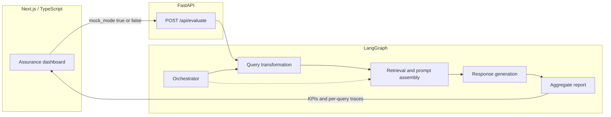

# Component-Level RAG & Agentic Assurance Analyzer

Audit a retrieval-augmented generation pipeline one stage at a time. The analyzer scores query rewriting, index routing, retrieval and prompt assembly, and answer generation. An agent controller then plans the question, calls a route-specific retrieval tool, retries once when that context is weak, and accepts or rejects the draft.

The shipped dataset is public US GAAP and SEC reporting material: ASC 606, ASC 842, ASC 944, ASC 280, ASC 350, Regulation G EBITDA reconciliations, Form 10-K discussion, and SOX 404 internal control assessment.

## Why component-level RAG assurance matters

In a regulated reporting process, a single end-to-end score hides the control that failed. A revenue-recognition answer can be fluent and still come from the wrong index, a truncated prompt, or a sentence that never appeared in the evidence. Component-level assurance keeps a trace for each control so an audit committee can see which gate held and which one did not.

Two evaluation modes serve different control objectives:

- **Deterministic evaluation** (Demo Mode) scores the logged artifacts with fixed rules: token preservation, exact route match, precision and recall, prompt containment, and claim overlap. The same log produces the same report. That makes the suite usable as a release gate in CI, where a drop in prompt integrity or a new ungrounded extra must fail the build without calling an external model.
- **Probabilistic evaluation** (Live LLM Judge) sends the rewrite and the answer to an OpenAI-compatible model and embeds retrieved text for cosine similarity. The model is useful when the judgment depends on nuance that a lexical rule only approximates. Route match stays an exact comparison so routing accuracy remains reproducible. Live mode requires `OPENAI_API_KEY`.

Demo Mode is the default. It is the mode the GitHub Actions workflow runs.

## Architecture



The UI at `http://localhost:3000` calls the API at `http://localhost:8000`. Query transformation covers both the rewrite judge and the route check. The aggregate stage computes pass rate, routing accuracy, average retrieval F1, average faithfulness, and the ungrounded-extras rate.

## Component evaluation taxonomy

| Component | Evaluation type | Metrics | Pass criteria |
|---|---|---|---|
| Query modification | Deterministic term-and-constraint audit in Demo Mode. Structured LLM judge in Live Mode. | Preservation score 1–5, ambiguity (`low`, `medium`, `high`) | Preservation ≥ 4 and ambiguity other than `high` |
| Query routing | Deterministic comparison of the logged routes in both modes | Expected route, actual route, confidence 0–1 | Exact route match and confidence ≥ 0.70 |
| Retrieval and prompt assembly | Overlap math in both modes. Embedding cosine in Live Mode; lexical cosine in Demo Mode. Prompt check is always deterministic. | Context precision, context recall, F1, cosine similarity, prompt integrity | Precision, recall, and F1 ≥ 0.50, and the assembled prompt contains the full user query and every retrieved chunk |
| Response generation | Claim-overlap judge in Demo Mode. LLM-as-a-judge in Live Mode. | Faithfulness 0–1, answer relevancy 0–1, alignment tier 0–3 | Faithfulness ≥ 0.70, relevancy ≥ 0.50, and tier ≥ 2 |

Alignment tiers:

| Tier | Meaning |
|---|---|
| 3 | Complete alignment |
| 2 | Partial alignment |
| 1 | Complete alignment with ungrounded extras |
| 0 | Partial alignment with hallucinated extras |

The ungrounded-extras rate is the share of answers in tier 1 or tier 0.

## Quickstart

Python 3.11 or newer and Node.js 22 or newer are required for local development. Docker Compose is the alternative.

### Local development

Backend:

```bash
cd backend
python -m venv .venv
.venv\Scripts\activate
pip install -r requirements-dev.txt
uvicorn app.main:app --reload --port 8000
```

On macOS or Linux, activate the virtual environment with `source .venv/bin/activate`.

Frontend, in a second terminal:

```bash
cd frontend
npm ci
npm run dev
```

Open [http://localhost:3000](http://localhost:3000). The dashboard runs the demo audit on load. Copy `backend/.env.example` to `backend/.env` and set `OPENAI_API_KEY` before switching the UI to Live LLM Judge.

Run the assurance tests from `backend`:

```bash
pytest
```

The suite includes a release gate that fails when prompt-assembly integrity on the shipped dataset is below 100%.

### Docker

From the repository root:

```bash
docker compose up --build
```

The UI is published on port 3000 and the API on port 8000. The browser calls `http://localhost:8000`, so both ports stay on the host. To enable the live judge, export `OPENAI_API_KEY` in the shell before `docker compose up`. Demo Mode runs with the variable empty.

## CI

`.github/workflows/ci.yml` runs on every push and pull request:

- Backend: `pytest` on Python 3.12
- Frontend: `npm run lint` (`tsc --noEmit`) and `npm run build` on Node.js 22

## Sample audit

`backend/data/sample_eval_dataset.json` contains 8 cases. Four pass every stage at alignment tier 3: ASC 944 claim reserves, ASC 350 goodwill, ASC 326 credit losses, and Basel III operational-risk capital. The other four show a variable-consideration answer with an ungrounded deferral rule, a PCAOB sampling question routed to financial reporting, an ASC 842 retrieval that misses the discount-rate reassessment, and a non-GAAP rewrite that expands one-time severance into all compensation.
